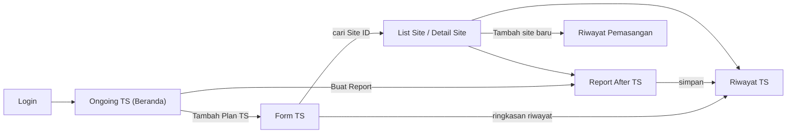
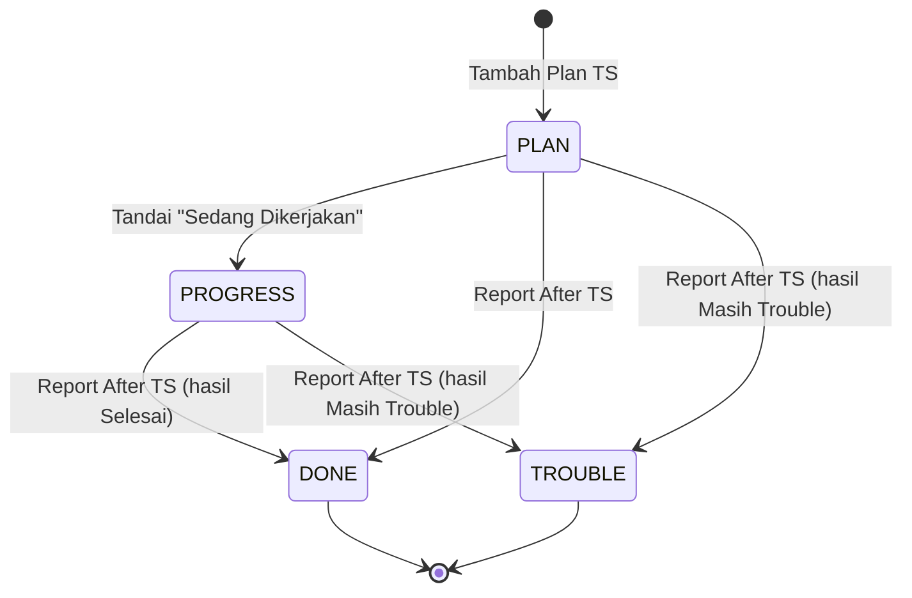
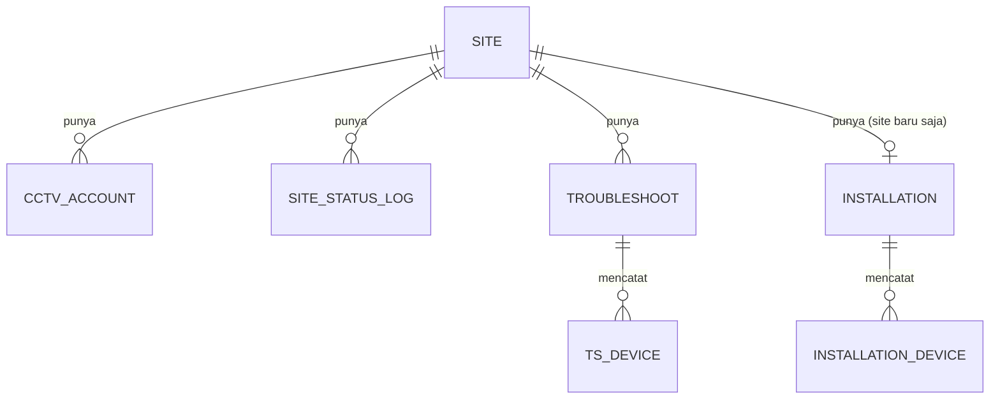

# PRD — Dashboard Monitoring & Troubleshoot Site DMT (NMS IoT)

| | |
|---|---|
| **Versi** | 1.0 |
| **Tanggal** | 13 November 2026 |
| **Status** | Draft |
| **Stack** | Frontend: React + Vite (Node.js) · Backend: Django + Django REST Framework |
| **Sumber data awal** | `LISTSITE.xlsx`, `MAINTENANCE - NAYAKA.xlsm` |

---

## 1. Latar Belakang

Saat ini monitoring dan troubleshoot (TS) site DMT dikelola lewat file Excel `MAINTENANCE - NAYAKA.xlsm` yang terdiri dari beberapa sheet:

| Sheet | Fungsi saat ini |
|---|---|
| `LISTSITE` | Master data 1.008 site |
| `CCTV MAIVIEW` | Akun CCTV per site |
| `1. REPORT SITE` | Log harian site bermasalah (offline/degraded) |
| `DEGREED` | Daftar site degraded beserta status VPN & respon |
| `2. ONGOING TS` | TS yang sedang berjalan |
| `3. REPORT TS` | Riwayat TS yang sudah dikerjakan |
| `PROSEDUR` | Gambar SOP |

Masalah yang muncul:
- Pemindahan TS dari *ONGOING* ke *REPORT TS* bergantung pada macro VBA (isi `DONE` → baris disalin lalu dihapus). Rawan salah dan tidak tercatat siapa/kapan.
- Banyak baris sisa formula (`0`, `#N/A`, `#REF!`) yang membingungkan.
- Riwayat TS satu site sulit dilihat sekaligus; harus filter manual.
- Tidak ada catatan perangkat apa saja yang ditangani saat TS (CCTV, Blackbox, RUT, dll).
- File besar (±5,7 MB), hanya bisa dibuka satu orang dengan nyaman, tidak ada akses web.

## 2. Tujuan

1. Memindahkan proses monitoring & TS dari Excel ke aplikasi web yang sederhana.
2. Semua riwayat TS yang sudah ada di Excel **masuk ke sistem** (tidak mulai dari nol).
3. Satu klik untuk melihat seluruh riwayat sebuah site (info, CCTV, kondisi, riwayat TS).
4. Alur TS jelas: **Plan → Dikerjakan → Report → Riwayat**.
5. Tampilan **simple dan mudah dimengerti**, tanpa elemen berkilau/animasi berlebihan.

### Metrik Keberhasilan
| Metrik | Target |
|---|---|
| Data riwayat TS Excel yang berhasil diimport | 100% baris valid (102 baris REPORT TS, 8 baris ONGOING TS) |
| Waktu membuat Plan TS baru | < 1 menit |
| Waktu menemukan riwayat TS sebuah site | < 10 detik (cukup ketik Site ID) |
| Excel tidak lagi dipakai untuk TS harian | Setelah 2 minggu go-live |

## 3. Pengguna

Aplikasi hanya memiliki **satu akun pengguna** (tim NOC/maintenance NMS IoT). Tidak ada pembagian peran; pengguna yang login dapat melihat, menambah, mengubah, dan menghapus semua data.

## 4. Ruang Lingkup

### Masuk Lingkup (v1)
- Login / logout satu akun.
- Halaman Ongoing TS (beranda) + form Plan TS.
- Form TS dengan pencarian Site ID & ringkasan riwayat.
- List Site (CRUD) + halaman Detail Site.
- Report After TS (tanggal plan, tanggal aktual, checklist perangkat, keterangan).
- Riwayat TS (lihat, filter, edit, hapus).
- Riwayat Pemasangan untuk **site baru** (di luar 1.008 site awal).
- Import data Excel (master site, akun CCTV, riwayat TS, TS ongoing, log status site).
- Export tabel ke Excel/CSV (Riwayat TS & List Site).

### Tidak Masuk Lingkup (v1)
- Monitoring real-time otomatis (ping/SNMP ke perangkat).
- Banyak user / pembagian peran / audit per user.
- Notifikasi WhatsApp/email.
- Peta interaktif site.
- Halaman SOP/bantuan (gambar PROSEDUR tetap di luar sistem).
- Penyimpanan kredensial WiFi/router site (lihat §11 Keamanan).

---

## 5. Alur & Sitemap



### Siklus Status TS



| Kode | Label di UI | Tampil di |
|---|---|---|
| `PLAN` | Direncanakan | Ongoing TS |
| `PROGRESS` | Sedang Dikerjakan | Ongoing TS |
| `DONE` | Selesai | Riwayat TS |
| `TROUBLE` | Masih Trouble | Riwayat TS (dengan opsi "Buat Plan TS Lanjutan") |

> Alur ini menggantikan macro VBA Excel: TS tidak perlu disalin-hapus, cukup berpindah status.

### Layout Umum
```
┌──────────────────────────────────────────────────────────────┐
│ Dashboard Maintenance NMS                       [ Keluar ]   │
├───────────────┬──────────────────────────────────────────────┤
│ Ongoing TS    │                                              │
│ List Site     │              (Isi halaman)                   │
│ Report After  │                                              │
│   TS          │                                              │
│ Riwayat TS    │                                              │
│ Riwayat       │                                              │
│   Pemasangan  │                                              │
└───────────────┴──────────────────────────────────────────────┘
```
Sidebar selalu tampil di semua halaman setelah login. Menu aktif ditandai dengan latar abu-abu muda + teks tebal.

---

## 6. Kebutuhan Fungsional per Halaman

### 6.1 Login
**Elemen:** Username, Password, tombol "Masuk".

| ID | Kebutuhan | Kriteria Penerimaan |
|---|---|---|
| LG-1 | Login dengan username & password | Jika benar → diarahkan ke Ongoing TS |
| LG-2 | Pesan error yang jelas | "Username atau password salah" (tanpa membedakan mana yang salah) |
| LG-3 | Semua halaman lain wajib login | Akses tanpa login → diarahkan ke Login |
| LG-4 | Logout | Tombol "Keluar" di header, sesi dihapus |
| LG-5 | Batasi percobaan login | Maks. 5 kali gagal / 15 menit |

Akun dibuat lewat `python manage.py createsuperuser` atau seed awal; password dapat diganti dari Django admin.

### 6.2 Ongoing TS (Beranda)
**Tujuan:** melihat semua TS yang belum selesai dan menambah plan TS baru.

```
┌ Ongoing TS ───────────────────────────────────── [ + Tambah Plan TS ] ┐
│ ┌──────────┐ ┌──────────┐ ┌──────────┐ ┌───────────────────┐          │
│ │ Ongoing  │ │Terlambat │ │ Selesai  │ │ Site Degraded     │          │
│ │    8     │ │    2     │ │ bln ini 5│ │      232          │          │
│ └──────────┘ └──────────┘ └──────────┘ └───────────────────┘          │
│ Cari: [ Site ID / nama ]  Regional: [Semua ▼]  Status: [Semua ▼]      │
│ ┌────────┬──────────────┬──────────┬───────┬────────┬───────┬───────┐ │
│ │Site ID │ Nama Site    │ Regional │Masalah│ Plan   │Status │ Aksi  │ │
│ ├────────┼──────────────┼──────────┼───────┼────────┼───────┼───────┤ │
│ │UJT-02..│Lancang_Kuning│SUMBAGTENG│NO RESP│20 Nov  │Plan   │Report │ │
│ └────────┴──────────────┴──────────┴───────┴────────┴───────┴───────┘ │
└───────────────────────────────────────────────────────────────────────┘
```

| ID | Kebutuhan | Kriteria Penerimaan |
|---|---|---|
| OT-1 | Kartu ringkasan (angka saja) | Ongoing (PLAN+PROGRESS), Terlambat (plan < hari ini & belum selesai), Selesai bulan ini, Site Degraded (dari log status terakhir) |
| OT-2 | Tabel TS ongoing | Kolom: Site ID, Nama Site, Regional, Kab/Kota, Status VPN, Respon, PIC 1, PIC 2, Plan Kunjungan, Keterangan, Status, Aksi |
| OT-3 | Penanda terlambat | Baris yang plan-nya lewat diberi label teks merah "Terlambat" (bukan animasi) |
| OT-4 | Pencarian & filter | Cari Site ID/nama; filter Regional & Status |
| OT-5 | Tombol "+ Tambah Plan TS" | Membuka Form TS (§6.3) |
| OT-6 | Aksi per baris | "Tandai Dikerjakan", "Buat Report" (→ §6.6, terisi otomatis), "Edit", "Hapus" |
| OT-7 | Klik Site ID | Membuka Detail Site |
| OT-8 | Urutan default | Plan kunjungan terdekat di atas; yang terlambat paling atas |

### 6.3 Form TS (Tambah / Edit Plan TS)
**Tujuan:** membuat plan TS dengan data site terisi otomatis dan riwayat terlihat sebelum berangkat.

```
┌ Tambah Plan TS ─────────────────────────────────────────────────────┐
│ Site ID: [ UJT-02-0|            ]  ← ketik, muncul saran            │
│                                                                     │
│ ┌ Data Site (otomatis dari List Site) ───────────────────────────┐  │
│ │ Nama: Lancang_Kuning   Project ID: 21TS02B4183                 │  │
│ │ Regional: SUMBAGTENG   Kab/Kota: Rokan Hilir   IP VPN: 10.x.x.x│  │
│ │ PIC 1: Junaidi / 0812...   PIC 2: Fauzan Akbar / 0823...       │  │
│ └────────────────────────────────────────────────────────────────┘  │
│ Status VPN: [NEW VPN ▼]   Respon: [NO RESPONSE ▼]                   │
│ Plan Kunjungan: [ 20/11/2026 ]                                      │
│ Keterangan masalah: [                                        ]      │
│                                                                     │
│ ┌ Ringkasan Riwayat TS site ini (3 terakhir) ─── Lihat semua → ┐   │
│ │ 22 Okt 2026  MCB ngetrip                       Selesai        │   │
│ │ 24 Sep 2026  MCB ngetrip                       Selesai*       │   │
│ └──────────────────────────────────────────────────────────────┘   │
│                                         [ Batal ]  [ Simpan Plan ]  │
└─────────────────────────────────────────────────────────────────────┘
```

| ID | Kebutuhan | Kriteria Penerimaan |
|---|---|---|
| FT-1 | Search bar Site ID dengan saran (autocomplete) | Mengetik ≥ 2 karakter menampilkan maks. 10 saran "SITE ID – Nama Site" dari master |
| FT-2 | Data site terisi otomatis | Nama, Project ID, Regional, Kab/Kota, IP VPN terisi & tidak dapat diubah di form ini (read-only) |
| FT-3 | PIC terisi otomatis | PIC 1 = Tim Implementasi, PIC 2 = Team Leader (boleh diubah) |
| FT-4 | Pilihan Status VPN | `NEW VPN`, `OLD VPN`, `VPN GONE` |
| FT-5 | Pilihan Respon | `NO RESPONSE`, `RESPONSE`, `RESPONSE \| OFFLINE` |
| FT-6 | Plan Kunjungan wajib diisi | Format tanggal dd/mm/yyyy; tidak boleh kosong |
| FT-7 | Ringkasan riwayat TS | Menampilkan 3 TS terakhir site tsb + jumlah total; link "Lihat semua" → Riwayat TS terfilter Site ID |
| FT-8 | Cegah duplikasi | Jika site sudah punya TS ongoing → tampil peringatan "Site ini masih punya TS yang belum selesai" + link ke TS tsb (tetap boleh simpan) |
| FT-9 | Site tidak ditemukan | Pesan "Site ID tidak ditemukan" + link "Tambah site baru" (→ §6.8) |
| FT-10 | Simpan | TS tersimpan dengan status `PLAN`, kembali ke Ongoing TS dengan pesan "Plan TS berhasil disimpan" |

### 6.4 List Site
| ID | Kebutuhan | Kriteria Penerimaan |
|---|---|---|
| LS-1 | Tabel site | Kolom: Site ID, Nama Site, Regional, Kab/Kota, IP VPN, Mitra, Kondisi Terakhir, Jumlah TS, Aksi. 25 baris per halaman |
| LS-2 | Pencarian & filter | Cari Site ID/nama/project ID; filter Regional, Mitra, Kondisi |
| LS-3 | Tambah site | Tombol "+ Tambah Site" membuka form Tambah Site Baru (§6.8) — otomatis tercatat di Riwayat Pemasangan |
| LS-4 | Edit site | Semua field master dapat diedit kecuali Site ID (Site ID unik) |
| LS-5 | Hapus site | Dialog konfirmasi "Hapus site X? Riwayat TS tetap disimpan." → site **diarsipkan** (soft delete), tidak muncul di list & pencarian |
| LS-6 | Aksi cepat | "Lihat Detail", "Buat Plan TS", "Buat Report" |
| LS-7 | Export | Tombol "Export Excel" sesuai filter aktif |

### 6.5 Detail Site
Dibuka dengan klik Site ID di mana pun. Data status/degraded **hanya** ditampilkan di halaman ini (tidak ada menu terpisah).

| Bagian | Isi |
|---|---|
| Info Site | Site ID, Project ID, Nama, Regional, Kab/Kota, Alamat, Lat-Long + link Google Maps, Tipe Tower, IP VPN, No IoT, Branch, Mitra, Milestone, Tim Implementasi, Team Leader |
| CCTV | Nama CCTV, Akun (email), Catatan (mis. "CCTV 2 OFFLINE") |
| Kondisi Terakhir | Status (Online/Offline/Degraded), Status VPN, Respon, tanggal update terakhir |
| Log Status Site | Tabel kronologis dari data *REPORT SITE* & *DEGREED*: Tanggal, Status, Reason, PIC |
| Riwayat TS | Semua TS site tsb (terbaru di atas) + perangkat yang ditangani |
| Riwayat Pemasangan | Hanya muncul jika site adalah site baru |

Pengguna dapat menambah entri log status dari halaman ini (tombol "+ Catat Kondisi": tanggal, status, reason).

### 6.6 Report After TS
**Tujuan:** mencatat hasil kunjungan TS. Bisa dibuka dari tombol "Buat Report" (TS sudah terisi) atau dari menu sidebar (pilih TS ongoing dulu).

```
┌ Report After TS ────────────────────────────────────────────────────┐
│ TS: [ UJT-02-083 – Lancang_Kuning (Plan 20/11/2026) ▼ ]             │
│                                                                     │
│ Tanggal Plan TS:   [ 20/11/2026 ]                                   │
│ Tanggal Aktual TS: [ 21/11/2026 ]                                   │
│                                                                     │
│ Perangkat yang ditangani:                                           │
│  [x] CCTV 1   [ ] CCTV 2   [x] Blackbox   [ ] VPN                   │
│  [ ] Rotary   [ ] Speaker  [x] RUT                                  │
│                                                                     │
│ Keterangan: [ MCB ngetrip, adaptor blackbox diganti           ]     │
│                                                                     │
│ Hasil:  (•) Selesai   ( ) Masih Trouble                             │
│ Catatan hasil: [ tinggal angle CCTV                          ]      │
│                                           [ Batal ] [ Simpan ]      │
└─────────────────────────────────────────────────────────────────────┘
```

| ID | Kebutuhan | Kriteria Penerimaan |
|---|---|---|
| RA-1 | Pilih TS | Dropdown berisi TS berstatus `PLAN`/`PROGRESS` (format "Site ID – Nama (Plan tgl)"), bisa dicari |
| RA-2 | Tanggal plan | Terisi otomatis dari Plan TS, bisa diubah |
| RA-3 | Tanggal aktual | Wajib, default hari ini, tidak boleh lebih dari hari ini |
| RA-4 | Checklist perangkat | CCTV 1, CCTV 2, Blackbox, VPN, Rotary, Speaker, RUT. Minimal 1 dicentang **atau** keterangan diisi |
| RA-5 | Keterangan | Teks bebas (wajib), contoh placeholder: "MCB ngetrip, adaptor rusak" |
| RA-6 | Hasil | Wajib pilih: Selesai (`DONE`) atau Masih Trouble (`TROUBLE`) |
| RA-7 | Catatan hasil | Opsional, untuk kasus seperti "DONE, tapi BB nya error" |
| RA-8 | Simpan | TS pindah ke Riwayat TS, hilang dari Ongoing TS, pesan "Report tersimpan" |
| RA-9 | Lanjutan | Jika hasil = Masih Trouble, tampil checkbox "Buat Plan TS lanjutan" → membuka Form TS dengan site yang sama |

### 6.7 Riwayat TS
| ID | Kebutuhan | Kriteria Penerimaan |
|---|---|---|
| RT-1 | Tabel riwayat | Kolom: Tanggal Aktual, Site ID, Nama Site, Regional, Status VPN, Respon, Perangkat, Keterangan, Hasil, Catatan, PIC, Sumber |
| RT-2 | Filter | Site ID, Regional, rentang tanggal, Hasil (Selesai/Masih Trouble), Perangkat |
| RT-3 | Tampilan per site | Pilihan "Kelompokkan per site" → daftar site + jumlah TS, klik untuk lihat riwayat masing-masing site |
| RT-4 | Edit | Semua field report dapat diubah |
| RT-5 | Hapus | Dialog konfirmasi; hapus permanen |
| RT-6 | Label sumber | Data hasil import ditandai label kecil "Import Excel" |
| RT-7 | Export | Export Excel sesuai filter, kolom setara sheet `3. REPORT TS` |

### 6.8 Riwayat Pemasangan
**Aturan:** halaman ini hanya berisi **site baru yang ditambahkan setelah sistem berjalan** (di luar 1.008 site hasil import). 1.008 site awal tidak memiliki data pemasangan.

| ID | Kebutuhan | Kriteria Penerimaan |
|---|---|---|
| RP-1 | Form Tambah Site Baru | Bagian A — data site (field sama dengan List Site, Site ID wajib & unik). Bagian B — data pemasangan: Tanggal Pemasangan (wajib), Tim Implementasi, Mitra, Perangkat Terpasang (checklist: CCTV 1, CCTV 2, Blackbox, VPN, Rotary, Speaker, RUT), IP VPN, Catatan |
| RP-2 | Satu form untuk dua halaman | Tombol "Tambah Site" di List Site dan "Tambah Pemasangan" di halaman ini membuka form yang sama |
| RP-3 | Simpan | Site masuk List Site **dan** data pemasangan tercatat di Riwayat Pemasangan |
| RP-4 | Tabel | Kolom: Tanggal Pemasangan, Site ID, Nama Site, Regional, Tim, Mitra, Perangkat Terpasang, Catatan, Aksi |
| RP-5 | Edit / Hapus | Edit data pemasangan; hapus data pemasangan dengan konfirmasi (site tetap ada di List Site) |
| RP-6 | Filter | Rentang tanggal, Regional, Mitra |

---

## 7. Model Data



### 7.1 `Site`
| Field | Tipe | Keterangan | Sumber Excel |
|---|---|---|---|
| id | PK | | |
| site_id | varchar(30), unik | Mis. `BKS-04-206`, `TAB147` | `SITE ID` |
| project_id | varchar(30) | | `ID Project` |
| name | varchar(150) | | `SITE NAME` |
| site_label | varchar(200) | | `Site id Site Name` |
| regional | varchar(30) | | `REGIONAL` (dinormalisasi) |
| city | varchar(100) | Kab/Kota | `KABUPATEN/KODYA` |
| tower_type | varchar(50), null | | `Tinggi & Tipe Tower` (.xlsm) |
| ip_vpn | varchar(45), null | | `IP VPN` (LISTSITE.xlsx) |
| latitude, longitude | decimal(9,6), null | | `Lat Long` |
| address | text | | `Alamat` |
| maps_url | url, null | Otomatis dari lat-long jika kosong | `Link Google Maps` (.xlsm) |
| partner | varchar(30), null | TSEL / PST / Komitel | `Mitra` (.xlsm) |
| milestone | varchar(30), null | RFS | `Milestone` (.xlsm) |
| implementation_team | varchar(150) | Nama / No HP | `Tim Implementasi` |
| team_leader | varchar(150) | Nama / No HP | `Nama Team Leader` |
| iot_number | varchar(20), null | | `NO IOT` (DEGREED) |
| branch | varchar(50), null | | `BRANCH` (DEGREED) |
| source | enum | `IMPORT` / `NEW` | — |
| is_archived | bool | Soft delete | — |
| created_at, updated_at | datetime | | — |

### 7.2 `CctvAccount`
site (FK), cctv_name, account_email, note — dari `CCTV MAIVIEW` (fallback `Nama CCTV`/`Email CCTV` di LISTSITE.xlsx).

### 7.3 `SiteStatusLog`
| Field | Tipe | Keterangan |
|---|---|---|
| site | FK | |
| date | datetime | |
| status | enum null | `ONLINE` / `OFFLINE` / `DEGRADED` |
| vpn_status | enum null | `NEW_VPN` / `OLD_VPN` / `VPN_GONE` |
| response | enum null | `NO_RESPONSE` / `RESPONSE` / `RESPONSE_OFFLINE` |
| reason | varchar(200) | Teks bebas (mis. "STOLEN", "CCTV OFF") |
| pic | varchar(150) | |
| note | text | |
| source | enum | `REPORT_SITE` / `DEGREED` / `MANUAL` |

### 7.4 `Troubleshoot`
| Field | Tipe | Keterangan |
|---|---|---|
| site | FK | |
| status | enum | `PLAN` / `PROGRESS` / `DONE` / `TROUBLE` |
| vpn_status | enum null | |
| response | enum null | |
| pic1, pic2 | varchar(150) | |
| plan_date | date null | |
| actual_date | date null | Wajib saat DONE/TROUBLE |
| problem | text | Keterangan masalah (saat plan) |
| description | text | Keterangan hasil kunjungan (report) |
| result_note | varchar(255) | Catatan hasil, mis. "tapi BB nya error" |
| parent | FK self null | TS lanjutan dari TS sebelumnya |
| source | enum | `IMPORT` / `INPUT` |
| created_at, updated_at | datetime | |

### 7.5 `TsDevice` / `InstallationDevice`
ts / installation (FK), device (enum: `CCTV1`, `CCTV2`, `BLACKBOX`, `VPN`, `ROTARY`, `SPEAKER`, `RUT`). Unik per (parent, device).

### 7.6 `Installation`
site (OneToOne), install_date, team, partner, ip_vpn, note, created_at.

---

## 8. Migrasi Data dari Excel

Dijalankan lewat management command:
```
python manage.py import_excel --listsite LISTSITE.xlsx --maintenance "MAINTENANCE - NAYAKA.xlsm" [--dry-run]
```
- **Idempotent:** dijalankan ulang tidak membuat data ganda (kunci: Site ID; TS: Site ID + tanggal + keterangan).
- `--dry-run` hanya menampilkan ringkasan tanpa menyimpan.
- Menghasilkan **laporan import** (`import_report.csv`) berisi baris yang dilewati beserta alasannya.

### 8.1 Urutan & Pemetaan

| # | Sumber | Target | Catatan |
|---|---|---|---|
| 1 | `LISTSITE.xlsx` (1.008 baris) | `Site` (`source=IMPORT`) | Sumber utama, IP VPN asli |
| 2 | `.xlsm` → `LISTSITE` (header di baris 2) | Lengkapi `Site`: tower_type, maps_url, partner, milestone | Cocok 100% berdasarkan Site ID |
| 3 | `.xlsm` → `CCTV MAIVIEW` (893 baris) | `CctvAccount` | 6 Site ID tidak ada di master → masuk laporan, dilewati |
| 4 | `.xlsm` → `DEGREED` (232 baris) | `SiteStatusLog` (`status=DEGRADED`, `source=DEGREED`) + isi `Site.iot_number`, `Site.branch` | Plan Kunjungan/Keterangan/Progress disimpan di `note`. Kolom `NOTE` & kolom tanpa judul (legenda) diabaikan |
| 5 | `.xlsm` → `1. REPORT SITE` (252 baris, header di baris 3) | `SiteStatusLog` (`source=REPORT_SITE`) | Status kosong (141 baris) → `status=null`. Site ID `lsm-01-031` tidak ada di master → laporan |
| 6 | `.xlsm` → `3. REPORT TS` (102 baris) | `Troubleshoot` (`source=IMPORT`) | Lihat aturan §8.2 |
| 7 | `.xlsm` → `2. ONGOING TS` (8 baris valid) | `Troubleshoot` `status=PLAN` | Baris dengan Site ID kosong / nilai `0` / `#N/A` dilewati (9 baris) |

### 8.2 Pemetaan Kolom `3. REPORT TS` → `Troubleshoot`
| Kolom Excel | Field | Aturan |
|---|---|---|
| SITE ID | site | Lookup master |
| STATUS | vpn_status | `NEW VPN`/`OLD VPN`/`VPN GONE`; kosong → null |
| REASON | response | `NO RESPONSE`/`RESPONSE`/`RESPONSE \| OFFLINE`; kosong → null |
| PIC1 / PIC2 | pic1 / pic2 | Rapikan spasi & baris baru |
| TANGGAL TS | actual_date & plan_date | |
| KETERANGAN | description | |
| PROGRESS | status + result_note | `DONE` → `DONE`; `DONE, <teks>` → `DONE` + result_note `<teks>`; `MASIH TROUBLE` → `TROUBLE`; kosong → `TROUBLE` + masuk laporan "progress kosong, perlu dicek" |
| — | devices | Kosong (data lama tidak punya checklist perangkat) |

### 8.3 Aturan Pembersihan Data
| Masalah | Aturan |
|---|---|
| `#N/A`, `#REF!`, `0`, string kosong | Disimpan sebagai `null` |
| Variasi regional (`JABO` vs `JABODETABEK`, `JABAR` vs `JAWA BARAT`/`Jawa Barat`, `JATENG` vs `JAWA TENGAH`) | Regional mengikuti master site. Nilai master dinormalisasi ke huruf kapital |
| Lat-Long dengan pemisah spasi atau koma | Dipecah jadi latitude & longitude desimal; gagal parse → null + laporan |
| PIC berisi baris baru / karakter tak terlihat (`\u202a`, `\u202c`) | Dibersihkan, format "Nama / No HP" |
| Ejaan `DEGREED`, `NO RESPONS` | Dinormalisasi ke `DEGRADED`, `NO_RESPONSE` |
| Huruf kecil di Site ID | Pencocokan tidak membedakan huruf besar/kecil |

---

## 9. Desain API (Django REST Framework)

Base URL: `/api/`. Semua endpoint (kecuali login) butuh sesi login. Respons JSON, paginasi `?page=&page_size=` (default 25).

| Method | Endpoint | Fungsi |
|---|---|---|
| POST | `/auth/login/` | Login |
| POST | `/auth/logout/` | Logout |
| GET | `/auth/me/` | Cek sesi |
| GET | `/dashboard/summary/` | Angka kartu ringkasan Ongoing TS |
| GET, POST | `/sites/` | List (filter `search`, `regional`, `partner`, `condition`) / tambah |
| GET | `/sites/lookup/?q=` | Autocomplete Site ID (maks. 10) |
| GET, PATCH, DELETE | `/sites/{site_id}/` | Detail / edit / arsipkan |
| GET | `/sites/{site_id}/summary/` | Data untuk Form TS: info site + 3 TS terakhir + TS ongoing |
| GET, POST | `/sites/{site_id}/status-logs/` | Log status site |
| GET, POST | `/sites/{site_id}/cctv/` | Akun CCTV |
| GET, POST | `/troubleshoots/` | List (filter `status`, `site`, `regional`, `date_from`, `date_to`, `device`) / buat plan |
| GET, PATCH, DELETE | `/troubleshoots/{id}/` | Detail / edit / hapus |
| POST | `/troubleshoots/{id}/start/` | Ubah ke `PROGRESS` |
| POST | `/troubleshoots/{id}/report/` | Simpan Report After TS (tanggal, devices, keterangan, hasil) |
| GET, POST | `/installations/` | List / tambah site baru + pemasangan (satu transaksi) |
| GET, PATCH, DELETE | `/installations/{id}/` | Detail / edit / hapus |
| GET | `/export/troubleshoots.xlsx` | Export riwayat TS |
| GET | `/export/sites.xlsx` | Export list site |

**Contoh — `POST /api/troubleshoots/{id}/report/`**
```json
{
  "plan_date": "2026-11-20",
  "actual_date": "2026-11-21",
  "devices": ["CCTV1", "BLACKBOX", "RUT"],
  "description": "MCB ngetrip, adaptor blackbox diganti",
  "result": "DONE",
  "result_note": "tinggal angle CCTV"
}
```

---

## 10. Panduan UI (Simple & Mudah Dimengerti)

### Prinsip
1. **Polos & datar:** tanpa gradient, glow, glassmorphism, efek kilau, animasi berlebih, atau ikon dekoratif. Bayangan (shadow) tidak dipakai; pemisah cukup garis border 1px.
2. **Bahasa Indonesia sehari-hari** untuk semua label, tombol, dan pesan.
3. **Satu halaman, satu tugas utama.** Tombol aksi utama selalu di kanan atas.
4. **Tabel adalah tampilan utama**, dengan pencarian & filter di atasnya.
5. **Konfirmasi** sebelum hapus; **pesan sukses/gagal** singkat setelah simpan.

### Warna
| Penggunaan | Warna |
|---|---|
| Latar | `#FFFFFF` (konten), `#F5F6F7` (sidebar) |
| Teks | `#1F2328` (utama), `#5F6368` (sekunder) |
| Border | `#D0D7DE` |
| Aksi utama (tombol) | `#1F5FAD` (biru solid) |
| Status Selesai / Online | Teks `#1A7F37` di latar `#E6F4EA` |
| Status Masih Trouble / Offline / Terlambat | Teks `#B42318` di latar `#FDECEA` |
| Status Direncanakan / Degraded | Teks `#9A6700` di latar `#FFF4D6` |
| Status Sedang Dikerjakan | Teks `#1F5FAD` di latar `#E8F0FB` |

Status selalu berupa **teks label** (bukan hanya warna) agar tetap terbaca bagi pengguna buta warna.

### Tipografi & Komponen
- Font sistem (`system-ui, Segoe UI, Roboto, Arial`), ukuran dasar 14px, judul halaman 20px.
- Tombol: kotak sudut 4px, tanpa efek selain perubahan warna saat hover.
- Form: label di atas input, tanda `*` untuk wajib, pesan error merah di bawah field.
- Tanggal ditampilkan `dd MMM yyyy` (contoh: 21 Nov 2026).
- Tabel: header tebal, baris zebra abu-abu sangat muda, kolom Site ID dapat diklik.
- Empty state berupa kalimat penjelas, mis. "Belum ada TS yang sedang berjalan. Klik **+ Tambah Plan TS** untuk membuat."
- Responsif minimal untuk layar laptop (≥ 1280px) dan tablet (≥ 768px); di HP sidebar menjadi menu lipat.

---

## 11. Kebutuhan Non-Fungsional

| Aspek | Kebutuhan |
|---|---|
| Keamanan | Password di-hash (default Django), session cookie `HttpOnly` + CSRF, HTTPS di produksi, rate-limit login |
| Kredensial site | **Password WiFi/router site yang ada di gambar SOP tidak boleh disimpan atau ditampilkan di dashboard.** Disarankan password tersebut segera diganti karena sudah tersebar di file Excel |
| Performa | List 1.000+ site dengan filter < 1 detik; pencarian autocomplete < 300 ms |
| Ketersediaan data | Backup database harian (pg_dump), simpan 14 hari |
| Integritas | Site ID unik; hapus site = arsip (riwayat tetap ada) |
| Kompatibilitas | Chrome, Edge, Firefox versi terbaru |
| Zona waktu | `Asia/Jakarta` |

---

## 12. Tech Stack & Struktur Proyek

| Layer | Teknologi |
|---|---|
| Frontend | React 18 + Vite, React Router, TanStack Query, React Hook Form, CSS Modules (atau Tailwind tanpa plugin efek) |
| Backend | Python 3.12+, Django 5, Django REST Framework, django-filter, openpyxl |
| Database | PostgreSQL 16 (produksi), SQLite (development) |
| Auth | Django session auth + CSRF (frontend memakai proxy Vite `/api` saat development) |
| Deploy | Nginx (serve build React + reverse proxy ke Gunicorn/Django) |

```
Maintenance NMS Dashboard/
├── backend/
│   ├── manage.py
│   ├── config/                 # settings, urls
│   ├── sites/                  # Site, CctvAccount, SiteStatusLog
│   ├── troubleshoots/          # Troubleshoot, TsDevice
│   ├── installations/          # Installation, InstallationDevice
│   └── importer/
│       └── management/commands/import_excel.py
├── frontend/
│   ├── index.html
│   ├── vite.config.js
│   └── src/
│       ├── api/                # fungsi pemanggil API
│       ├── components/         # Table, StatusBadge, Sidebar, ConfirmDialog
│       ├── pages/              # Login, OngoingTS, FormTS, SiteList, SiteDetail,
│       │                       # ReportAfterTS, RiwayatTS, RiwayatPemasangan
│       └── styles/
├── LISTSITE.xlsx
├── MAINTENANCE - NAYAKA.xlsm
└── prd.md
```

---

## 13. Tahapan Rilis

| Fase | Isi | Hasil |
|---|---|---|
| 1. Fondasi | Setup Django + React, login, layout & sidebar | Bisa login dan pindah menu |
| 2. Master & Import | Model data, command `import_excel`, List Site, Detail Site | Seluruh data Excel tampil di sistem |
| 3. Alur TS | Ongoing TS, Form TS, Report After TS, Riwayat TS | Siklus Plan → Report → Riwayat berjalan |
| 4. Pemasangan & Export | Riwayat Pemasangan, Tambah Site Baru, export Excel | Fitur lengkap v1 |
| 5. Uji & Go-live | Uji pengguna, validasi hasil import vs Excel, deploy, backup | Excel berhenti dipakai untuk TS |

### Kriteria Selesai v1
- Jumlah data di sistem sama dengan Excel: 1.008 site, 102 riwayat TS, 8 TS ongoing (dikurangi baris yang tercatat di laporan import).
- Seluruh kebutuhan di §6 lolos kriteria penerimaan.
- Pengguna bisa membuat Plan TS → Report → melihat di Riwayat TS tanpa panduan.

---

## 14. Risiko & Catatan

| Risiko | Mitigasi |
|---|---|
| Data Excel tetap diubah selama masa transisi | Import idempotent dapat dijalankan ulang; tetapkan tanggal "freeze" Excel |
| Riwayat TS lama tidak punya checklist perangkat | Ditandai "Import Excel"; checklist boleh dilengkapi manual lewat Edit |
| Satu akun dipakai bersama → tidak tahu siapa yang mengubah data | Simpan `created_at`/`updated_at`; multi-user dapat dipertimbangkan di v2 |
| Kredensial router tersebar di file SOP | Tidak dimasukkan ke sistem; rekomendasikan penggantian password |
| Nilai regional/PIC tidak konsisten | Normalisasi saat import + dropdown regional di form |

### Keputusan yang Sudah Disepakati
1. Frontend React + Vite.
2. Riwayat Pemasangan hanya untuk site baru di luar 1.008 site awal.
3. Login hanya username & password.
4. Satu akun pengguna, tanpa pembagian peran.
5. Data DEGREED & REPORT SITE hanya tampil di Detail Site.

